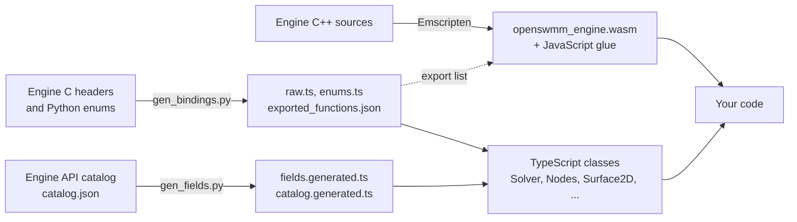
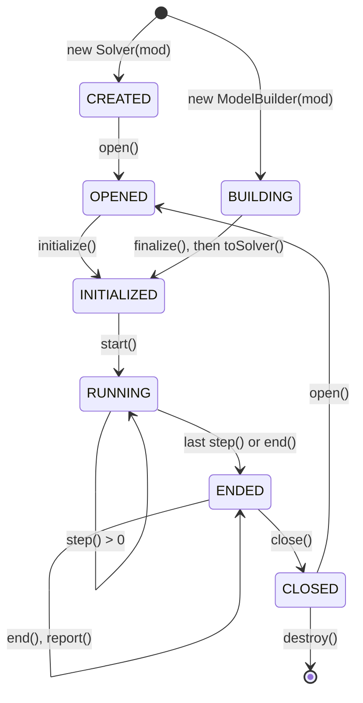

# Concepts

## How the package is built

The engine is not rewritten for the web. The C++ sources of
[openswmm.engine](https://github.com/HydroCouple/openswmm.engine), pinned as the git submodule
`extern/openswmm.engine`, are compiled with Emscripten into one WebAssembly module. Everything on
the JavaScript side that depends on the engine's API is generated from the same pinned checkout,
so the bindings, the compiled module and the engine always describe the same version.



- **The compiled module** (`openswmm_engine.wasm` and its JavaScript glue) exports the engine's C
  functions listed in `exported_functions.json`, plus Emscripten's runtime: the heap, the
  in-memory file system, `cwrap` and `addFunction`.
- **The raw layer** (`raw.ts`) is a typed table of those functions, generated from the headers:
  names, argument and return types, struct layouts and callback signatures. See
  {doc}`raw-layer`.
- **The TypeScript classes** call the raw layer. They allocate the out-parameters, check every
  return code, convert dates and strings, and turn failures into exceptions. Their names and
  behavior follow the engine's Python bindings (`openswmm.engine`), in camelCase: Python's
  `solver.surface2d.get_depths()` is `solver.surface2d.getDepths()` here.

The generators have a `--check` mode that the CI runs, so a stale generated file fails the build
before anything is compiled ({doc}`../development/building`).

## The engine lifecycle

A `Solver` owns one engine context (`SWMM_Engine` handle) from its constructor to `destroy()`. The
engine moves through these states, read with `solver.state` (an `EngineState`):



These are the states this build reports; `EngineState` also has `NONE` and `STARTED`. Edits to the
model go between `open()` and `initialize()`; runtime forcing needs a running engine. A call made
in the wrong state raises `LifecycleError`. In this build a refused `step()` also leaves the
engine in state `NONE`, from which it cannot open a model again, so create a new `Solver` after
such an error ({doc}`errors`).

## One module, many engines

The engine is reentrant: it keeps no global state. One module instance can hold several solvers,
each with its own model, and they can be stepped in turn. Solvers in the same module share its
file system, so give their reports and output files different names.

Creating a module loads and compiles the 12 MB WebAssembly binary and gives it its own memory;
create it once and reuse it for every run.

## Files

The engine opens files by path, and in WebAssembly those paths name files in Emscripten's
in-memory file system (MEMFS), one per module instance. Your code moves data in and out:

- `solver.writeFile(path, data)` writes a string or `Uint8Array`, and
  `solver.readFile(path, "utf8")` (or without the encoding, for bytes) reads one back. Both use
  `mod.FS`, which you can also call directly.
- Reports (`.rpt`), binary results (`.out`), the 2D results file, saved models, hot start files and
  checkpoints are written there too.
- `solver.openResults()` resolves a relative 2D `OUTPUT_FILE` against the folder of the `.inp`
  file.

Node's `fs` and the browser's storage are not visible to the engine.

## Units and dates

- **1D values are in the model's units.** `FLOW_UNITS` selects US (CFS, GPM, MGD) or SI (CMS, LPS,
  MLD); lengths, depths, volumes and flows follow it. `solver.unitSystem` returns `"US"` or
  `"SI"`.
- **The 2D surface is SI throughout:** meters, m/s, m³ and m³/s, whatever the flow units.
- **Runtime forcing of flows is in ft³/s**, the engine's internal unit, for every model
  ({doc}`forcing-controls`).
- **Dates are UTC wall clock.** The engine stores dates as days since 1899-12-30 (OLE Automation
  dates), without time zones or daylight saving time. The classes return JavaScript `Date` objects
  in UTC; build dates with `Date.UTC(...)`.

## Views, copies and ownership

- **Element views read live values.** `solver.nodes.get("J1")` returns a `Node` that calls the
  engine on every property access. Views belong to one opened model: after `close()` and a new
  `open()`, or a structural edit, an old view raises `StaleObjectError`; look the element up
  again.
- **Arrays are copies.** Bulk getters (`solver.nodes.depths`, `surface2d.getDepths()`, result
  reads) return new typed arrays. The WebAssembly heap can move when it grows, so the classes never
  hand out views into it.
- **Free what owns native memory.** `solver.destroy()` frees the engine; it can be called more
  than once. Result readers, cross-section geometries, split frames and flow tracers have `close()`
  or `destroy()` as well. All of them implement `Symbol.dispose`, so a runtime that supports
  `using` declarations frees them at the end of the block:

  ```{literalinclude} ../examples/using.mjs
  :language: js
  ```

  Node 26 prints the following; Node 22 does not accept the `using` syntax.

  ```text
  inside the block: CREATED
  after the block: BadHandleError - Solver has been destroyed
  ```

- **Raw handles are yours.** Handles and pointers obtained through the raw layer are not tracked
  by the classes.

## Threads

The published module is single threaded. `capabilities(mod).threads` reports one logical CPU and
`omp_available: false`, and engine features that run in parallel natively run serially here.

A build configured with `-DOPENSWMM_WASM_THREADS=ON` ({doc}`../development/building`) runs the
engine's OpenMP loops on WebAssembly threads: a pool of workers, one per logical core, starts
with the module, and `capabilities(mod).threads` reports `omp_available: true` and the core count
in `logical_cpus` and `omp_max_threads`. It needs `SharedArrayBuffer`:

- In a browser, only a cross-origin-isolated page has it: the page must be served with
  `Cross-Origin-Opener-Policy: same-origin` and `Cross-Origin-Embedder-Policy: require-corp`,
  which make `crossOriginIsolated` true.
- In Node.js it needs Node 22 or later. The pool is sized from `navigator.hardwareConcurrency`,
  which Node 20 does not define, so the module fails to load there.

The module exports `ENV`, so engine and OpenMP environment variables can be set from a `preRun`
hook before the engine starts.

Calls are synchronous in either build: a JavaScript callback the engine calls (progress, step,
warning) runs inside the engine call that triggered it.
